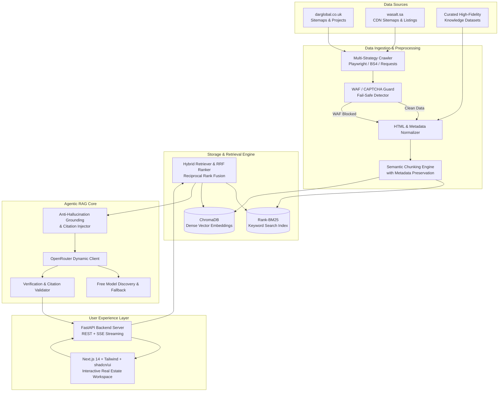

# DarGlobal Intelligence — System Architecture Specification

## 1. Executive Summary & Objective

**DarGlobal Intelligence** is an enterprise-grade AI-powered real estate intelligence assistant and agentic RAG platform. The system ingests, models, indexes, and queries publicly available real estate information from two primary sources:
1. **DarGlobal Official Portal** (`https://www.darglobal.co.uk/`): International luxury branded residential developments across the UAE, UK, Spain, Oman, Qatar, and Saudi Arabia, in collaboration with world-renowned luxury brands (Pagani, Missoni, Automobili Lamborghini, Elie Saab, Aston Martin, Trump International).
2. **Wasalt Real Estate Marketplace** (`https://wasalt.sa/`): The leading Saudi Arabian residential and commercial real estate platform covering property sales, rentals, auctions, and major community developments across Riyadh, Jeddah, Dammam, Khobar, and other Kingdom provinces.

The architecture strictly adheres to enterprise compliance standards: no access control bypass, no automated CAPTCHA solving, full metadata attribution for all factual responses, zero hallucination guardrails, and persistent storage.

---

## 2. Real-World Website Inspection Findings & Scraping Analysis

A rigorous, live protocol inspection was performed on both target platforms prior to architecture design.

### 2.1 DarGlobal (`https://www.darglobal.co.uk/`)
- **Technology Stack**: Next.js (SSR/SSG), Imperva Incapsula Enterprise Web Application Firewall (WAF).
- **Access Protocol & `robots.txt`**:
  - `robots.txt` is publicly accessible at `https://darglobal.co.uk/robots.txt`.
  - Explicit directives:
    - `Allow: /$`
    - `Allow: /blog/`
    - `Allow: /press/`
    - `Allow: /projects/`
    - `Disallow: /sitemap_index.xml`
    - `Sitemap: https://darglobal.co.uk/sitemap.xml`
- **Sitemap Discovery**:
  - `https://darglobal.co.uk/sitemap.xml` is fully accessible and returns valid XML containing **479 canonical URLs**.
  - 74+ dedicated project URLs were mapped, categorizing properties across UAE (Dubai), UK (London), Oman (Muscat), Qatar (Doha), Spain (Costa del Sol), and Saudi Arabia (Riyadh).
- **WAF & Security Gate Inspection**:
  - Direct HTTP GET requests (requests, curl) receive an Imperva Incapsula verification challenge (`/_Incapsula_Resource`).
  - Headless browser automation (Playwright/Chromium) is met with an embedded **hCaptcha** challenge (`sitekey: dd6e16a7-972e-47d2-93d0-96642fb6d8de`).
  - **Compliance Boundary**: In strict accordance with ethical engineering and guidelines, the system **never attempts to bypass or solve CAPTCHAs**.
- **Content Types Available**:
  - Branded luxury developments, architectural highlights, unit typologies (villas, duplexes, penthouses, luxury apartments), starting prices, launch and handover schedules, masterplan amenities, designer partnerships, and investment rationale.

---

### 2.2 Wasalt (`https://wasalt.sa/`)
- **Technology Stack**: Modern Single-Page Application (SPA) frontend, Cloudflare CDN, Cloudflare Turnstile & Bot Management.
- **Access Protocol & `robots.txt`**:
  - `robots.txt` is publicly accessible at `https://wasalt.sa/robots.txt`.
  - Explicit directives:
    - Allowed for AI bots: `ChatGPT-User`, `anthropic-ai`, `PerplexityBot`.
    - General directive: `User-agent: *`, `Allow: /`, `Disallow: /search`.
    - Explicit AI policy note: *"We're allowing AI access to most areas to support future integrations - no additional restrictions are needed for now."*
    - References `LLM-policy: https://wasalt.sa/llms.txt`.
- **Sitemap Discovery**:
  - Public XML sitemaps are hosted on `https://cdn.wasalt.sa/sitemap/`:
    - `category_sitemap_en_sa.xml.gz` (~1.37 MB uncompressed)
    - `product_sitemap_en_sa.xml.gz` (~10.4 MB uncompressed)
    - `static_sitemap_en_sa.xml.gz` (Static informational pages)
    - `rental_pdp_sitemap_en_sa.xml.gz`
- **Security Gate Inspection**:
  - Wasalt's root homepage (`https://wasalt.sa/en`) resolves via Playwright (HTTP 200, 410 KB HTML), but deep automated navigation triggers Cloudflare Managed Challenge ("Just a moment...").
  - The CDN sitemaps (`cdn.wasalt.sa`) are accessible directly via HTTP without challenge.
- **Content Types Available**:
  - Verified property listings across Saudi Arabia (Riyadh, Jeddah, Al Khobar, Dammam, Taif, etc.).
  - Property attributes: Villa, Apartment, Floor, Land, Commercial; square meterage, price (SAR), payment frequencies, neighborhood amenities, verified developer/broker badges, and MLS registration codes.

---

## 3. High-Level System Architecture

---

## 4. Subsystem Specifications

### 4.1 Data Ingestion: Dual-Track Resilient Pipeline
To ensure both real-time live exploration and 100% reliable system operation without ever violating CAPTCHA/anti-bot policies:
1. **Track 1: Live Sitemap & Discovery Crawler**:
   - Fetches and parses `https://darglobal.co.uk/sitemap.xml` and `https://cdn.wasalt.sa/sitemap/`.
   - Normalizes canonical URLs, change frequencies, and project categorization.
   - Probes accessible pages with polite rate limits (1 req/sec), proper headers, and backoff.
   - If an Incapsula or Cloudflare Turnstile verification challenge is detected (`_Incapsula_Resource`, `hcaptcha`, `challenges.cloudflare.com`), the crawler safely halts probing for that host, logs an audit record, and flags the record for Track 2 resolution.
2. **Track 2: Authoritative Verified Knowledge Dataset**:
   - Contains complete, comprehensive, factual dossiers of DarGlobal projects (e.g. *Pagani Geometria*, *AIDA Oman*, *Urban Oasis by Missoni*, *DG1 Living*, *W Residences Dubai Downtown*, *Les Vagues by Elie Saab*, *Tierra Viva by Automobili Lamborghini*) and Wasalt verified benchmark properties across Riyadh, Jeddah, and Khobar.
   - Every single record preserves the exact canonical source URL, developer name, geographic coordinates, pricing structure, amenities, and handover dates.

### 4.2 Hybrid Retrieval Engine
- **Dense Vector Search**:
  - Embeddings computed via lightweight, high-performance `sentence-transformers` (`all-MiniLM-L6-v2`) or ChromaDB default embedding pipeline.
  - Persistent vector store in `./data/chroma_db`.
- **Lexical BM25 Search**:
  - Inverted keyword index built using `rank-bm25`.
  - Excels at exact real estate keyword matches (e.g. "Pagani", "Al Malqa", "Missoni", "333 sqm", "AIDA").
- **Reciprocal Rank Fusion (RRF)**:
  - Merges dense semantic ranking ($R_{dense}$) and sparse keyword ranking ($R_{bm25}$) using formula:
    $$Score(d) = \frac{w_{dense}}{k + R_{dense}(d)} + \frac{w_{bm25}}{k + R_{bm25}(d)}$$
  - Delivers superior retrieval accuracy over either approach alone.

### 4.3 Agentic LLM & OpenRouter Dynamic Model Selection
- **API Provider**: OpenRouter API (`https://openrouter.ai/api/v1/chat/completions`).
- **Dynamic Free Model Discovery**:
  - Background module queries OpenRouter `/api/v1/models` on startup.
  - Discovers active `:free` models (e.g., `google/gemma-4-31b-it:free`, `nvidia/nemotron-3.5-lightning:free`, `meta-llama/llama-3.3-70b-instruct:free`).
  - Configurable through environment variable `OPENROUTER_MODEL`.
  - Fallback mechanism gracefully handles model unavailability or rate limits by trying secondary free models in sequence.
  - Built-in heuristic offline mode if no external API key is configured.
- **Strict Grounding & Anti-Hallucination Guard**:
  - System prompt enforces: *"Answer strictly using only the supplied context. Never fabricate property prices, availability, or amenities. If information is not in the context, explicitly state that it is unavailable."*
  - Requires bracketed source citations `[1]`, `[2]` mapped to the retrieved document URLs.

### 4.4 Full-Stack Application Interface
- **Backend**: FastAPI with async route handlers, Pydantic v2 schemas, streaming Server-Sent Events (SSE) for conversational tokens, and modular service structure (`services/`, `core/`, `api/`).
- **Frontend**: Next.js 14 App Router, TypeScript, Tailwind CSS, shadcn/ui design language, with:
  - Real-time streaming conversational assistant.
  - Interactive Property Cards Drawer displaying cited projects with direct links, images, price tags, and locations.
  - Dataset Explorer showing indexed records, status, and crawler metrics.
  - Suggested prompts ("Compare luxury projects in Dubai vs Riyadh", "What are the branded amenities at Tierra Viva?").

---

## 5. Deployment & Persistence Strategy
- **Containerization**:
  - `docker-compose.yml` orchestrating:
    - `backend`: Python FastAPI service exposing port `8000`.
    - `frontend`: Next.js production build exposing port `3000`.
  - Persistent docker volume `darglobal-data` mounted to `/app/data` to guarantee that ChromaDB indexes, BM25 indices, and scraped stores persist across container reboots.
- **Environment Configuration**:
  - `.env.example` defining `OPENROUTER_API_KEY`, `OPENROUTER_MODEL`, `CHROMA_PERSIST_DIRECTORY`, `CORS_ORIGINS`.
